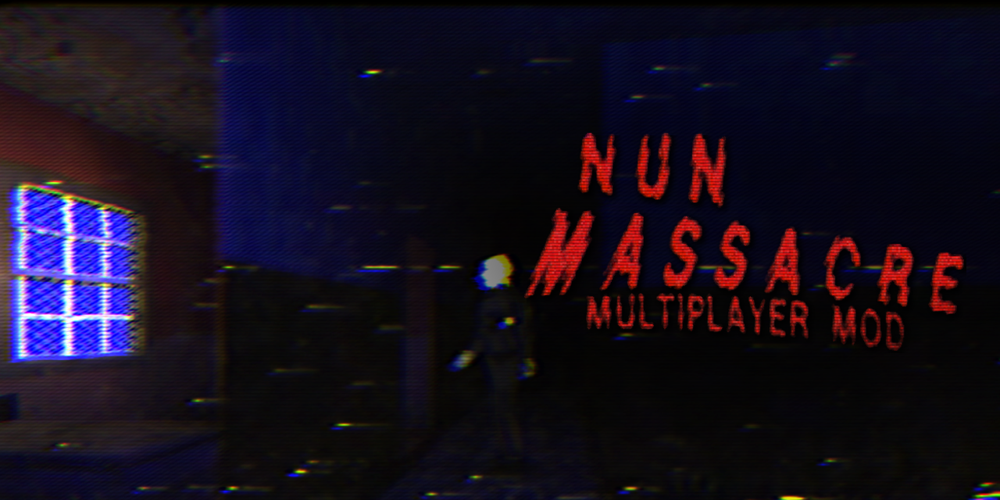
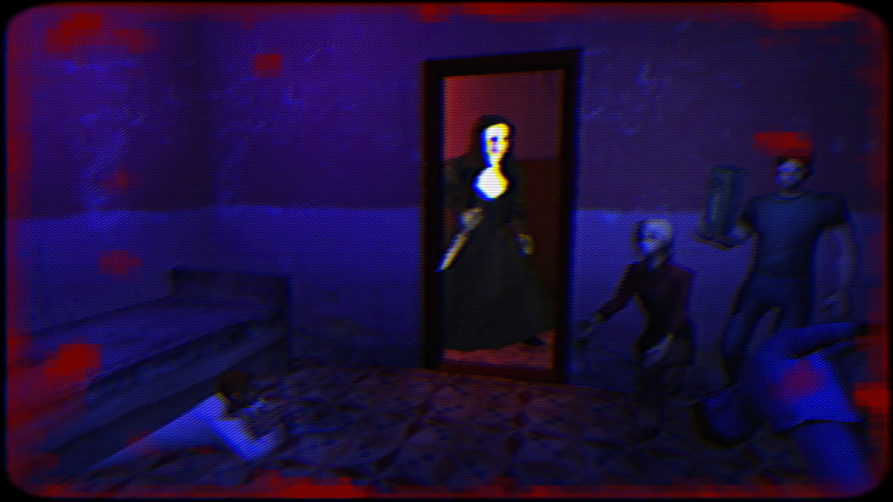

# Nun Massacre Co-op — 1.0.0

A multiplayer mod for **Nun Massacre Definitive Edition** (Windows, build 2022.06.08). Up to four players survive the Nun together, with proximity voice chat, revives, and a Nun who hears you through the building.

Every player needs their own copy of the game and the same version of the mod.

## Install

1. Run **NunMassacreCoop-Setup.exe**. It finds the game by itself; if it doesn't, press **BROWSE** and pick `Nun Massacre.exe`.
2. Press **INSTALL**, then **PLAY**, and choose **MULTIPLAYER** on the main menu.

The setup never changes the game's own files. Run it again to **UPDATE** or **UNINSTALL**.

## Playing online

**The host needs UPnP turned on in their router's settings.** Hosting then opens the game's port by itself and makes an invite code for your friends. Most routers have UPnP on already. If the lobby says the router did not open the port, open your router's settings page (usually `192.168.0.1` or `192.168.1.1`, or the address on the router's sticker), turn on UPnP, and host again.

If you can't turn it on:

- let a friend whose router has UPnP host, or
- forward TCP port **27845** to your PC in the router's settings (friends then join with your public IP address), or
- all join the same free virtual LAN (Radmin VPN, ZeroTier or Tailscale) and type the host's VPN address (shown in the VPN app) into the invite code box, then press **Enter**.

Windows Firewall may ask the first time you host: allow it.

## Playing together

1. **Host:** MULTIPLAYER → enter **YOUR NAME** → **HOST GAME**. The invite code is copied to your clipboard; send it to your friends.
2. **Friends:** MULTIPLAYER → enter your name → click the invite code box and paste the code (**Ctrl+V**). You join straight away. On the same network as the host, you can instead select the host's game in the list under the box.
3. **Host:** **START GAME**, then choose the difficulty and scenario as usual. Everyone starts together.

In the lobby, **YOUR SETTINGS** sets your name, your character (Mike, Maddy, Mark or Maverick), your voice and your microphone. The host also chooses **NUN HEARING**: **CO-OP** (the default: voices and footsteps carry to her through the building) or **ORIGINAL** (she hears as in the game alone). Friends can join a game that is already running. If the host quits, the game ends for everyone.

## How co-op plays

- **Knocked down, not killed.** At 0 health you go down and can crawl. A teammate revives you by holding **Interact** next to you (faster with a first aid kit). You have five minutes. Out of lives, you spectate until the next level.
- **The Nun hunts everyone,** and goes after whoever is alone. Shout to pull her off a friend.
- **She hears you** (with CO-OP hearing). Voices, footsteps, whistles and dropped things travel through the building to her, further the harder the difficulty.
- **Proximity voice chat,** muffled through walls and echoing in big rooms. Open mic or push to talk (**V**).
- **Hide two to a bed.**
- **Shared puzzles, scares and endings.** Anyone can work on any puzzle. Scares and endings wait for the whole team, then happen to everyone at once.
- **A lighter, map and bandages for each player;** one radar and one revolver for the team.

## Controls

| Action | Key |
|---|---|
| Revive a teammate | Hold **Interact** next to them |
| Give up while down | Hold **Jump** for 2 seconds |
| Point / whistle | **1** / **2** |
| Team roster | Hold **Tab** |
| Push to talk (if chosen) | Hold **V** |
| Spectating: next view / free camera | **Interact** / **Jump** |
| Console | **F2** |

**Console commands** (host): `players`, `bring <player>`, `goto <player>`, `unstuck [player|all]`, `revive <player>`, `kick <player>`. Guests can use `players` and `unstuck`.

## Troubleshooting

- **Friends can't join with the invite code:** check that UPnP is on in the host's router (see [Playing online](#playing-online)) and that Windows Firewall allows Nun Massacre on the host. A new code is made each time you host.
- **"Different game build or co-op mod version":** everyone needs build 2022.06.08 and the same mod version.
- **No voice:** open **VOICE & MIC** in the lobby and check the microphone, the mic test and the mic level. If teammates hear an echo, use headphones.
- **Stuck in an animation:** press **F2** and type `unstuck`.
- **Anything else:** include `BepInEx/LogOutput.log` from the game folder with your bug report.

## Credits

Multiplayer mod by **NetworkPlasma**.

- Raytraced audio: **Powered by Vercidium Audio** ([vercidium.com](https://vercidium.com)), used under its free non-commercial licence.
- Character models by **Vinrax** ([sketchfab.com/vinrax](https://sketchfab.com/vinrax)):
  - "Redneck Character PSX Style" (https://skfb.ly/pypzp) by vinrax is licensed under Creative Commons Attribution (http://creativecommons.org/licenses/by/4.0/). Played as Maverick, the cigarette left out.
  - "Female Secretary Character PSX" (https://skfb.ly/oQoOE) by vinrax is licensed under Creative Commons Attribution (http://creativecommons.org/licenses/by/4.0/). Played as Maddy.
  - "Scientist PSX style" (https://skfb.ly/oA8NX) by vinrax is licensed under Creative Commons Attribution (http://creativecommons.org/licenses/by/4.0/). Played as Mark.
  - Mike, by Vinrax.
- Motion capture: Mixamo. Mod loader: BepInEx 5 and Harmony.
- Nun Massacre is a game by Puppet Combo.

Building from source: [docs/BUILDING.md](docs/BUILDING.md).
